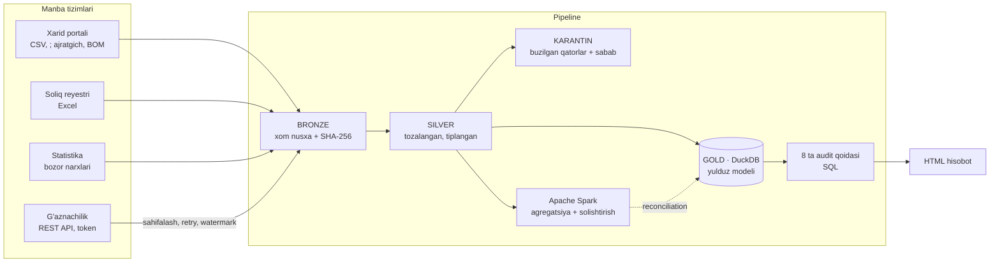
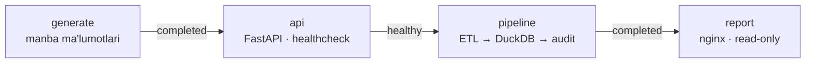

# Xarid Audit Platform

[](https://github.com/devSeeK1/xarid-audit-platform/actions/workflows/ci.yml)

**Davlat xaridlari audit-analitika platformasi.** Platforma turli davlat tizimlaridan ma'lumotlarni avtomatik yig'adi, tozalaydi, ma'lumotlar omboriga (DWH) yuklaydi va moliyaviy qonunbuzarlik belgilarini qoidalar asosida aniqlaydi.

Loyiha davlat auditining tipik vazifasini yechadi: ma'lumot bir necha tizimda (xarid portali, soliq reyestri, g'aznachilik) turli formatda saqlanadi va ularni qo'lda solishtirish haftalab vaqt oladi. Platforma bu ishni **2,1 mln qator ma'lumot uchun taxminan 12 soniyada** bajaradi va auditorga tekshirish uchun tayyor ro'yxat beradi.

> ⚠️ Real davlat ma'lumotlari ochiq emas, shuning uchun loyiha **sintetik ma'lumotlar** bilan ishlaydi. Barcha tashkilot nomlari, STIR va PINFL raqamlari tasodifiy yaratilgan.

---

## Natijalar (to'liq hajmda)

| Ko'rsatkich | Qiymat |
|---|---|
| Manba tizimlari | 5 ta (REST API, CSV, Excel, 2 ta ma'lumotnoma) |
| Qayta ishlangan qatorlar | 2 141 109 (605 900 shartnoma, 1 509 809 to'lov, 25 400 reyestr yozuvi) |
| Karantinga ajratilgan buzilgan qatorlar | 15 178 (har biri sababi bilan) |
| Audit qoidalari | 8 ta |
| Ataylab qo'shilgan anomaliyalarni topish | **100%** (testlar bilan tasdiqlangan) |
| To'liq ishlov vaqti (Spark'siz) | ≈ 12 s · Extract 7,2 s · Transform 2,4 s · Load 1,3 s · Audit 0,7 s |
| Spark ↔ DuckDB natijalari farqi | **0** |
| Testlar | 34 ta, hammasi o'tadi |

Tayyor hisobot namunasi: [`reports/audit_report.html`](reports/audit_report.html). Faylni yuklab olib brauzerda oching yoki GitHub Pages orqali `docs/index.html` sahifasini ko'ring.

---

## Arxitektura



**Qatlamlar (medallion arxitekturasi):**

| Qatlam | Nima saqlanadi | Nima uchun |
|---|---|---|
| `data/sources` | Manba tizimlari (simulyatsiya) | Real hayotdagi formatlar va "iflos" ma'lumot |
| `data/bronze` | Manbadan o'zgarishsiz olingan nusxa (parquet) | Har doim xom ma'lumotga qaytish mumkin |
| `data/silver` | Tozalangan, yagona turga keltirilgan ma'lumot | Tahlil uchun ishonchli asos |
| `data/quarantine` | Sifat qoidasidan o'tmagan qatorlar va sabab | Ma'lumot yo'qolmaydi, manba egasiga qaytariladi |
| `data/warehouse` | DuckDB: `dwh` (yulduz modeli), `audit`, `meta` sxemalari | Auditorlar SQL bilan ishlaydi |

**Ombor modeli:** `fact_contract`, `fact_payment` jadvallari va `dim_buyer`, `dim_supplier`, `dim_category`, `dim_date` o'lchovlari, hamda `ref_market_price` ma'lumotnomasi.

---

## Audit qoidalari

Har bir qoida o'qilishi oson alohida SQL fayl (`sql/rules/`). Chegaralar `config/settings.yaml` faylidan olinadi.

| Kod | Qoida | Mantiq |
|---|---|---|
| R01 | Xaridni bo'lib-bo'lib amalga oshirish | 30 kun ichida bitta yetkazuvchidan bir toifada chegaraga yaqin ≥3 ta to'g'ridan-to'g'ri shartnoma, jami chegaradan oshgan |
| R02 | Ortiqcha to'lov | To'lovlar yig'indisi shartnoma summasidan >1% oshgan |
| R03 | Narxning sun'iy oshirilishi | Birlik narxi shu oydagi bozor medianasidan 1,8 baravardan qimmat |
| R04 | Yangi tashkil etilgan korxona | Ro'yxatdan o'tganiga 90 kun bo'lmagan korxona bilan ≥500 mln so'mlik shartnoma |
| R05 | Affillangan yetkazuvchilar | Direktori (PINFL xeshi) yoki manzili bir xil korxonalar bitta buyurtmachida g'olib bo'lgan |
| R06 | Yetkazuvchi konsentratsiyasi | Bitta yetkazuvchi buyurtmachining yillik xaridlaridan >40% ulush olgan |
| R07 | Shartnomadan oldin to'lov | To'lov sanasi shartnoma sanasidan oldin |
| R08 | Tugatilgan korxonaga to'lov | To'lov korxona rasman tugatilgandan keyin o'tkazilgan |

Har bir topilmaga og'irlik beriladi (`rule_weights`), natijada buyurtmachilar **xavf balli** bo'yicha tartiblanadi. Bu auditorga tekshiruvni birinchi navbatda qayerdan boshlashni ko'rsatadi.

> R01 qoidasi ataylab qo'shilgan barcha 60 ta holatdan tashqari yana 29 ta tabiiy tasodifiy holatni ham belgilaydi. Bu kutilgan natija: qoida xavf belgisini ko'rsatadi, yakuniy xulosani auditor chiqaradi.

---

## Ma'lumot sifati

Manba ma'lumotlarida real hayotdagi muammolar ataylab qoldirilgan va pipeline ularni hal qiladi:

- summalar uch xil formatda: `1250000.50`, `1 250 000,50`, `1,250,000.50`
- sanalar ikki xil formatda: `2024-03-15` va `15.03.2024`
- xarid usuli turlicha yozilgan: `" TENDER "`, `Tender`
- aynan takrorlangan qatorlar va API qayta yuborgan to'lovlar
- noto'g'ri STIR, noma'lum buyurtmachi, manfiy summa, davrdan tashqari sana
- yo'q shartnomaga bog'langan to'lovlar

Buzilgan qatorlar o'chirilmaydi: `data/quarantine/` papkasiga sababi bilan yoziladi, statistikasi `meta.dq_results` va `meta.dataset_stats` jadvallariga tushadi.

---

## Axborot xavfsizligi choralari

| Chora | Amalga oshirilishi |
|---|---|
| API autentifikatsiyasi | Bearer token, `hmac.compare_digest` bilan solishtiriladi (timing attack'dan himoya) |
| Maxfiy ma'lumotlar koddan tashqarida | Token va tuz `.env` faylida, u `.gitignore` orqali Git'ga yuklanmaydi |
| Shaxsiy ma'lumotlarni himoyalash | PINFL silver qatlamga o'tishdan oldin tuzlangan SHA-256 xeshga aylantiriladi. Affillanganlikni aniqlash mumkin, shaxsni tiklash mumkin emas |
| SQL in'eksiyadan himoya | Qoidalarga qo'yiladigan parametrlar faqat raqam bo'lishi tekshiriladi, `run_id` bog'langan parametr orqali uzatiladi |
| Ma'lumot yaxlitligi | Har bir manbaning SHA-256 nazorat yig'indisi `meta.source_lineage` jadvalida saqlanadi |
| Audit izi | Har bir ishga tushirish kim, qayerdan, qachon ishga tushirgani va natijasi bilan `meta.etl_runs` jadvaliga yoziladi |
| Barqarorlik | API xatolarida eksponensial kutish bilan qayta urinish. Watermark faqat butun jarayon muvaffaqiyatli tugaganda yangilanadi |
| Faqat o'qish huquqi | Hisobot va auditorlar omborga `read_only=True` rejimida ulanadi |

---

## Ishga tushirish

Talablar: **Python 3.11+**. Spark bosqichi uchun qo'shimcha ravishda **Java 17+** kerak (Windows'da WSL tavsiya etiladi).

```bash
git clone <repo-url> && cd xarid-audit-platform
python -m venv .venv
source .venv/bin/activate          # Windows PowerShell: .venv\Scripts\Activate.ps1
pip install -r requirements.txt    # Spark bilan: pip install -r requirements-spark.txt

cp .env.example .env               # Windows: copy .env.example .env
# .env ichidagi TREASURY_API_TOKEN va PII_SALT qiymatlarini o'zgartiring

python -m pipeline demo                 # ma'lumot yaratish + to'liq pipeline + hisobot
python -m pipeline demo --with-spark    # + Spark job va natijalarni solishtirish
python -m pipeline demo --scale 0.1     # tezkor sinov uchun kichik hajm
```

Bosqichma-bosqich ishlatish:

```bash
python -m pipeline generate             # sintetik manba tizimlari
python -m pipeline api                  # g'aznachilik mock API'si (alohida terminalda)
python -m pipeline run                  # o'sib boruvchi yuklash (faqat yangi to'lovlar)
python -m pipeline run --full-refresh   # hammasini qaytadan yuklash
python -m pipeline report               # hisobotni qayta qurish
```

Natija `reports/audit_report.html` faylida.

### Bitta xaridni tekshirish

Hisobotdagi istalgan shartnoma, to'lov yoki yetkazuvchi bo'yicha to'liq "ish yig'majildi"ni chiqarish:

```bash
python -m pipeline tekshir C0438999     # shartnoma: narx, bozor medianasi, to'lovlar, signallar
python -m pipeline tekshir P01437186    # to'lov: tegishli shartnoma ochiladi
python -m pipeline tekshir 930377665    # yetkazuvchi: bog'liq korxonalar, buyurtmachilar, signallar
```

Ombor bilan to'g'ridan-to'g'ri ishlash:

```python
import duckdb
con = duckdb.connect("data/warehouse/xarid_dwh.duckdb", read_only=True)
con.sql("SELECT * FROM audit.buyer_risk LIMIT 10").show()
```

---

## Loyiha tuzilmasi

```
config/settings.yaml        hajm, davr, audit chegaralari, qoidalar og'irligi
mock_api/app.py             g'aznachilik REST API'si (FastAPI, token, sahifalash)
pipeline/
  generate.py               sintetik manba tizimlari + ataylab qo'shilgan anomaliyalar
  extract/sources.py        CSV / Excel / API → bronze, SHA-256 lineage, retry
  transform/clean.py        parserlar, sifat qoidalari, karantin, PII xeshlash
  load/warehouse.py         DuckDB yulduz modeli, meta jadvallar, watermark
  audit/engine.py           qoidalar katalogi va dvigateli, xavf balli
  report/                   HTML hisobot (Jinja2 + SVG grafiklar)
  run.py                    orkestrator: bosqichlar, vaqt o'lchash, xatolarni boshqarish
  inspect.py                `tekshir` buyrug'i: bitta shartnoma/yetkazuvchi bo'yicha ish yig'majildi
spark_jobs/supplier_spend.py PySpark agregatsiyasi
sql/                        ombor sxemasi va 8 ta audit qoidasi
tests/                      34 ta test: parserlar, xavfsizlik, API, to'liq jarayon, tekshir buyrug'i
```

## Testlar

```bash
pytest -q
```

To'liq jarayon testi kichik hajmdagi ma'lumotda butun pipeline'ni ishga tushiradi va har bir qoida ataylab qo'shilgan **barcha** anomaliyalarni topganini tekshiradi. Shuningdek, karantin ishlashi, silver va omborda ochiq PINFL yo'qligi, lineage nazorat yig'indilari, API autentifikatsiyasi va sahifalash, o'sib boruvchi yuklash ham tekshiriladi.

---

## Docker va CI/CD

Butun platforma konteynerlarda bitta buyruq bilan ko'tariladi:

```bash
cp .env.example .env          # token va tuzni o'zgartiring
docker compose up -d report   # yoki: make up
# http://localhost:8080 — tayyor audit hisoboti
```



| Qism | Yechim |
|---|---|
| Image | Ikki bosqichli `Dockerfile`: bog'liqliklar alohida venv'da, runtime `python:3.13-slim`, root bo'lmagan `app` foydalanuvchi |
| Orkestratsiya | `docker-compose.yml`: servislar `depends_on` shartlari bilan ketma-ket ishga tushadi (`service_completed_successfully`, `service_healthy`) |
| Holat | Ma'lumot, hisobot va loglar nomlangan volume'larda. Hisobotni nginx faqat o'qish rejimida beradi, xavfsizlik sarlavhalari bilan |
| Maxfiy ma'lumotlar | Token va tuz `.env` orqali uzatiladi, image ichiga tushmaydi (`.dockerignore`) |
| Barqarorlik sinovi | `CHAOS_FAIL_RATE` bilan API tasodifiy 503 qaytaradi, pipeline retry orqali baribir yakunlanadi |

**GitHub Actions** (`.github/workflows/ci.yml`) har bir push va pull request'da:

1. `ruff` bilan lint va `pytest` bilan 34 ta test;
2. Docker image'ni build qiladi (GitHub Actions cache bilan);
3. **smoke test**: butun stekni `docker compose` bilan ko'taradi, 5% sun'iy API xatolari bilan pipeline'ni o'tkazadi va hisobot nginx orqali ochilishini tekshiradi;
4. `main` branch'da image'ni **GitHub Container Registry**'ga (`ghcr.io`) `latest` va commit SHA teglari bilan yuklaydi.

---

## Cheklovlar va rivojlantirish yo'nalishlari

- **Sintetik ma'lumot.** Real tizimga ulash uchun faqat `extract` qatlamidagi ulagichlarni almashtirish kifoya, qolgan qatlamlar o'zgarmaydi.
- **Watermark to'lov sanasi bo'yicha.** Real integratsiyada `updated_at` maydoni yoki CDC (o'zgarishlarni oqim sifatida olish) ishlatiladi.
- **Orkestratsiya.** Bosqichlar mustaqil funksiyalar, shuning uchun ularni Apache Airflow DAG'iga ko'chirish oson.
- **Masshtab.** DuckDB va Polars bitta serverda o'nlab million qatorni ko'taradi. Undan kattasi uchun xuddi shu mantiq Spark job'da allaqachon bor.
- **Keyingi bosqich.** Qoidalarga asoslangan aniqlashga mashinali o'rganish asosidagi anomaliya modelini (Isolation Forest) qo'shish va auditor izohlari uchun veb-interfeys yaratish.

---

**Muallif:** Oshirboyev Ezozjon · Python · SQL · Data Engineering · Axborot xavfsizligi
